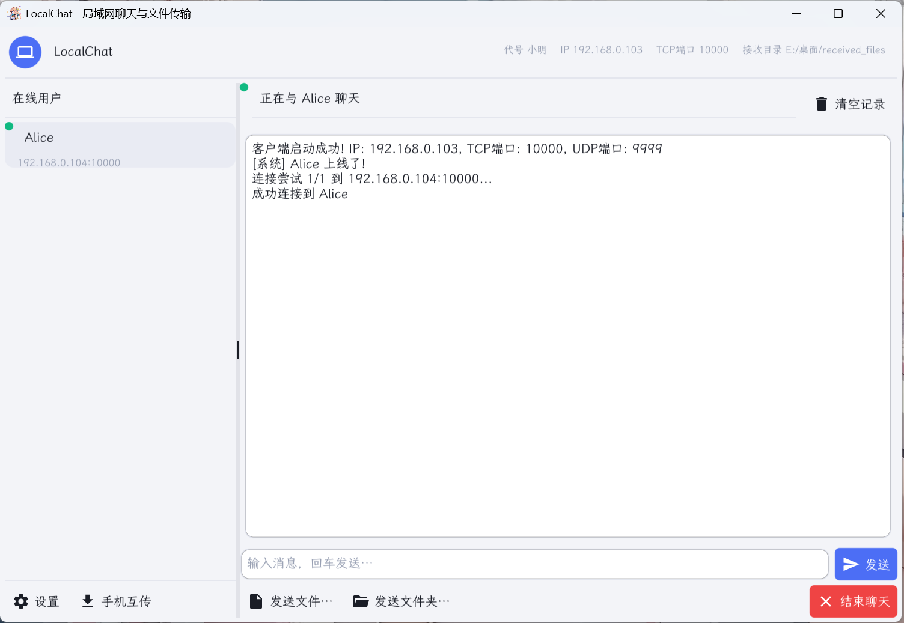
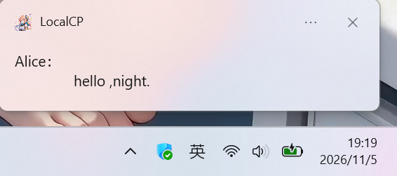
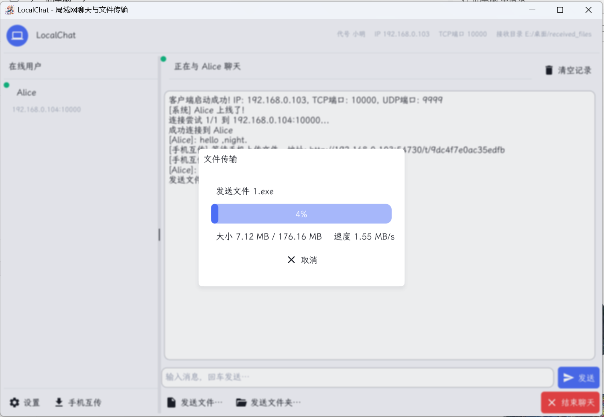
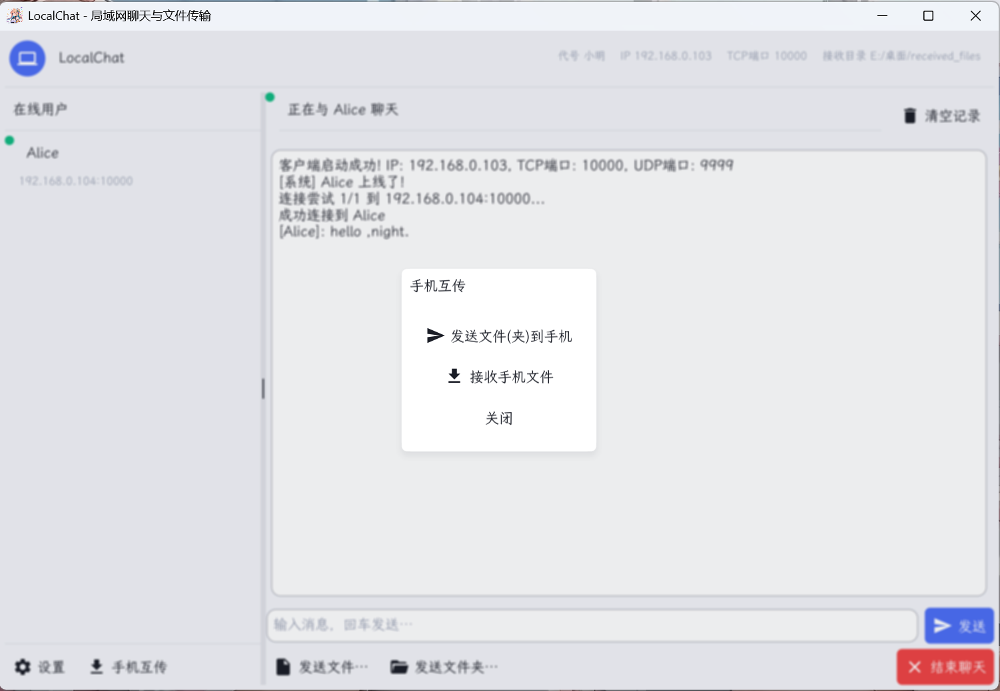
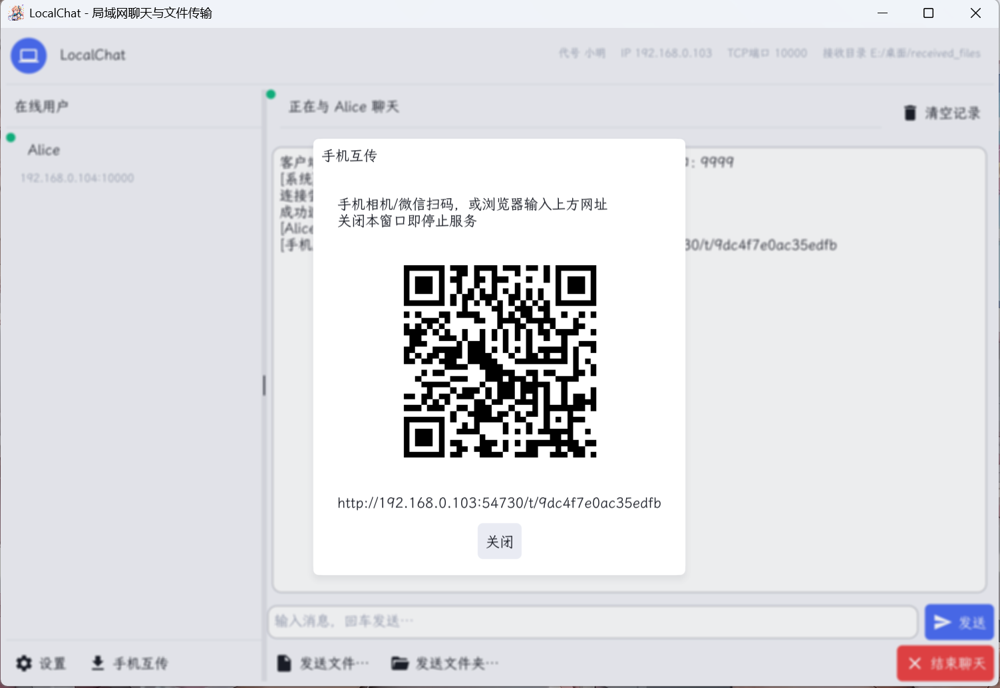

# 项目介绍

在同一网络下,安装此软件的多台电脑之间,可以发现对方设备,彼此之间进行聊天和文件互传。免登录,无需注册账号。方便快捷。
### 本项目已上架 Microsoft Store,可直接在Windows Store搜索[LocalCP](https://apps.microsoft.com/detail/9NLXCD3RLH6R?hl=zh-cn&gl=CN&ocid=pdpshare)下载使用。


#### 仓库中提供了windows版本的软件程序

- 根目录中 localchat.exe可以直接下载到桌面运行使用

###### 运行效果演示








## 编译方法

###### 注意:Linux环境下C++默认已经安装，fyne环境几乎无需配置，

###### 但是Windows环境下C++需要安装，等环境，参考如下：

> [fyne官网参考](https://docs.fyne.io/)\
> [msys2官网(C++下载地址)](https://www.msys2.org/)

######

***

### 先clone仓库

- 项目根目录下 go run .  \[ 或直接运行 main.go ]能运行后再打包编译成Windows版本软件

### 打包成Windows 程序软件

#### 项目根目录下

###### 安装fyne命令工具:

```Go
go install fyne.io/fyne/v2/cmd/fyne@latest  
```

###### 打包

##### windows打包命令:

```Go
fyne package -os windows -icon 1.ico -release -app-id com.ggbond.boom
```

